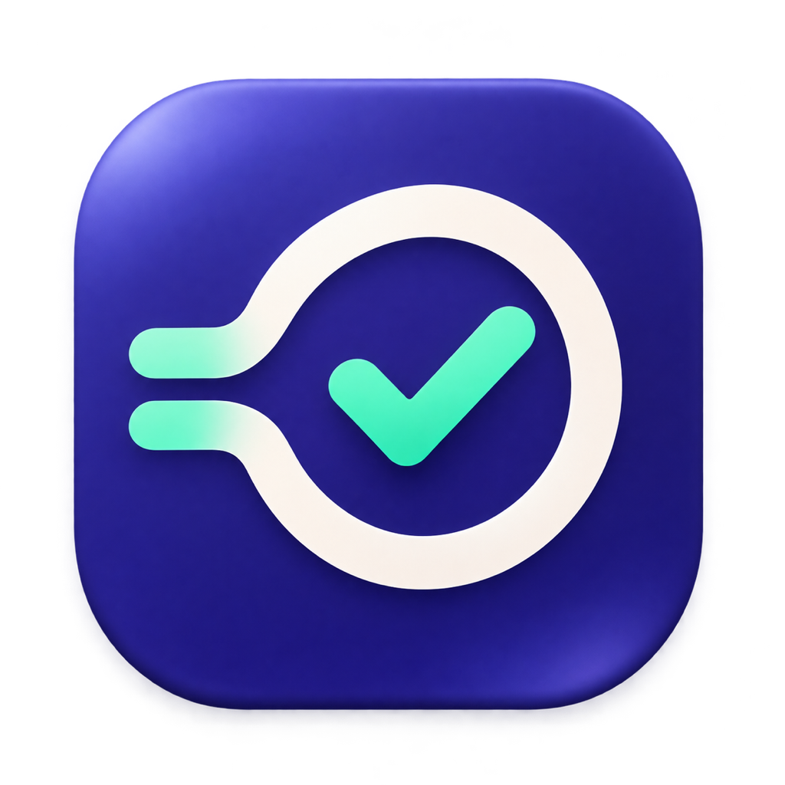

# 归期 · DueBridge

[](https://github.com/jjbnb/DueBridge/actions/workflows/ci.yml)

把浙江大学课程平台中有明确截止时间的任务汇总到提醒事项或日历。先预览，再由你启用同步。



这是面向特定学校接口的个人项目，与浙江大学及各平台无隶属或背书关系。

## 支持范围

| 来源 | 读取方式与范围 |
| --- | --- |
| BB | `learn.intl.zju.edu.cn` 的个人 ICS 日历订阅 |
| 智海 MO | `mo.zju.edu.cn` 学校网页登录及课程任务 |
| 学在浙大 | `courses.zju.edu.cn` 学校网页登录及作业、考试 |

仅同步明确截止时间；没有截止时间的任务会跳过。首次导入不新增往日任务；重复同步保留手动完成状态、个人备注和非本应用管理的提醒。源站任务消失时，不自动删除已有提醒；网页上的提交状态也不会自动勾选提醒事项。

macOS 版面向 Apple Silicon、macOS 14 及以上。现有提醒事项可继续使用，也可单独启用 Apple 日历，将任务写入你选定账户下的专用日历。选择 iCloud 后，可在同一 Apple 账户的设备查看。

Windows 11 x64 开发版独立读取 BB、智海 MO 和学在浙大，并写入个人 Outlook 日历。手机端可以使用 Outlook 查看同一账户的日历。Windows 构建、微软应用注册和真机验收见 [Windows 版指南](docs/windows.md)。

这是面向浙大接口的同步器。接口可能随平台调整而失效。

## 从源码运行

安装 Xcode Command Line Tools（或 Xcode）、Node.js 和 Python 3。终端中执行：

```sh
git clone https://github.com/jjbnb/DueBridge.git
cd DueBridge
./scripts/test.sh all
./scripts/build-app.sh
open build/DueBridge.app
```

构建使用当前 `xcrun` 选定的 macOS SDK、Swift 5 语言模式和 `arm64-apple-macosx14.0` 目标。输出仅在本项目 `build/` 内。详见[构建与验证](docs/building.md)。

云端默认在标准 Intel Mac 上运行原生合成测试，再交叉编译 ARM 应用并校验产物架构，避免依赖当前资源紧缺的 macOS ARM 机器池。本机默认仍运行 ARM 原生测试；GitHub 手动运行时也可选择 ARM 原生检查。

这是源码首发，不提供经过 Developer ID 签名及公证的安装包。本机构建使用 ad hoc 签名，重新构建后系统可能再次请求权限。项目不提供关闭系统安全保护的步骤。

## 首次设置

1. 打开应用，在目标列表设置中授权「提醒事项」完整访问，明确选择一个可写列表，或明确创建新列表。仅使用 MO / 学在浙大也可完成这一步，无需 BB 订阅。
2. 在所需来源中连接学校账号；BB 使用自己的私人日历订阅地址。MO / 学在浙大在学校网页窗口完成登录，再读取课程。
3. 核对预览中的课程、标题和截止时间，然后启用该来源同步。预览本身不会写入提醒事项。
4. 按需开启登录恢复；登录项还须得到系统允许。关闭窗口后应用是否仍运行，请以菜单栏状态为准；退出应用后不再检查。

要使用 Apple 日历，可在「Apple 日历」设置中授权并在所选账户创建专用日历，回到来源页预览，再启用该来源的日历同步。日历和提醒事项各自显示同步结果。日历事件保留任务的截止时刻或全天日期，倒计时在归期预览中显示。

已保存的目标列表消失或不可写时，同步会停止并要求处理，不会自动换到其他列表。MO / 学在浙大首次使用必须明确选择目标；BB 保留旧版兼容行为：从未设置目标时，启用 BB 同步会查找唯一的“BB DDL”列表，或在有可导入任务时建立该列表。推荐先在列表设置页明确选择目标。改选列表后，既有导入记录的保护规则仍生效，不会自动搬移任务或清空导入历史。

社区版标识为 `org.duebridge.community`，使用独立设置和钥匙串命名空间。第一次使用需要重新设置、登录和授权；不自动迁移现有版本的数据。任务标记格式保持兼容，因此不要让两个版本同时写入同一个列表。

## 运行与验证边界

自动检查依赖应用保持运行，按北京时间安排每日检查及有限失败重试；Mac 睡眠期间不保证准点执行，唤醒后再补查。系统权限、登录项审批和学校会话过期均可能阻止同步。

自动测试使用合成任务、模拟会话和本机编译。0.1.1 的同一 MO 修复已在本机安装版收到用户反馈：通行证登录、回跳及课程和任务预览正常。社区版独立身份的首装、真实提醒事项写入和系统重启仍需单独验收，不能据此保证所有账号和环境都已验证。

平台适配器通过静态注册扩展；测试中的第四个平台仅证明适配器契约，不是第四个已支持网站，也不会出现在正式应用里。见[适配器说明](docs/adapters.md)。

## 其他说明

- [版本更新](CHANGELOG.md)：源码版本与修复记录。
- [隐私说明](PRIVACY.md)：本机保存内容、联网范围与退出方式。
- [安全报告](SECURITY.md)：使用合成材料反馈问题。
- [参与开发](CONTRIBUTING.md)：测试、适配器和提交要求。
- [常见问题](docs/troubleshooting.md)：权限、登录、目标列表和后台运行。

代码按 [MIT 许可证](LICENSE) 发布，Copyright © 2026 jjbnb。图标由项目所有者使用 AI 图像生成工具创作，不是学校官方标志。
